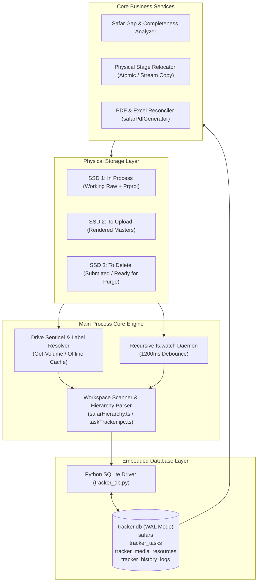
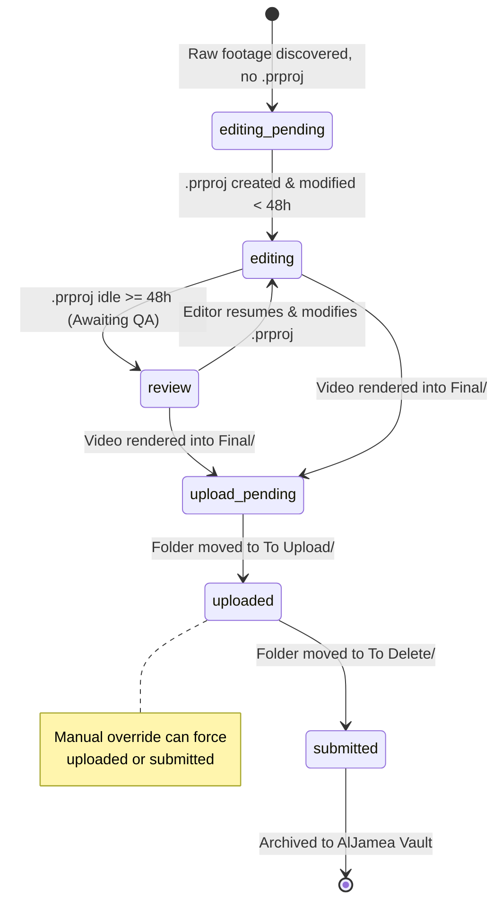

# Safar Tracker — Core Engine & Business Logic Specification

> **Scope Note:** This document specifies the pure architectural, algorithmic, and data logic of the **Safar Tracker (Task Tracker)** backend and core services. It intentionally excludes all UI components, React renderers, CSS styles, button layouts, and presentation layers.

---

## 1. Domain Overview & Problem Space

In the video production workflow for the Sultan al-Bohra's official tours (**Safar**):
* A **Safar** is a multi-day event series in a designated city (e.g., `1447-08 Mumbai - Urs Mubarak`, `1448-03 Mumbai`, `1448-05-08 Coimbatore`).
* Each Safar spans multiple days, and each day contains one or more recording sessions (Morning `_01M`, Evening `_02E`, Bethak, Majlis, QMZ, Waaz).
* Cameramen produce raw footage across multiple cameras (`CAM 01`, `CAM 02`, audio decks).
* Video editors assemble master timelines in Adobe Premiere Pro (`.prproj`), render deliverables into `Final/`, stage them in `To Upload/`, and ultimately transfer them to AlJamea tus Saifiyah central archives (`To Delete/`).
* Media assets are distributed across multiple fast NVMe SSDs, portable drives, and network shares. Drives are frequently plugged in and out.

The **Safar Tracker** is the automated production tracking engine that continuously inspects physical storage, maintains an SQLite ledger (`tracker.db`), evaluates stage progression, and detects production gaps without requiring manual data entry or external cloud servers.

---

## 2. System Architecture



---

## 3. Data Entities & Schema

The persistent state is maintained in an embedded SQLite database (`tracker.db`) initialized with `PRAGMA journal_mode = WAL`, `PRAGMA synchronous = NORMAL`, and 32MB cache.

### 3.1 `safars` (Parent Tour Entity)
Represents a complete Safar tour container.

| Column | Type | Description |
| :--- | :--- | :--- |
| `id` | `INTEGER PRIMARY KEY` | Auto-increment identifier. |
| `safar_name` | `TEXT UNIQUE NOT NULL` | Full directory name (e.g. `1448-03 Mumbai`). |
| `safar_year` | `INTEGER` | Hijri or Gregorian year (e.g. `1448`). |
| `safar_serial` | `TEXT` | Two-digit Safar sequence number (e.g. `03`). |
| `city` | `TEXT` | Extracted city name (e.g. `Mumbai`, `Surat`). |
| `total_days` | `INTEGER` | Total date/session deliverables discovered. |
| `completed_days`| `INTEGER` | Count of deliverables in `uploaded` or `submitted` state. |
| `is_safar_done` | `INTEGER` | `1` when `completed_days >= total_days && total_days > 0`. |
| `current_path` | `TEXT` | Current physical filesystem directory path. |
| `current_drive` | `TEXT` | Drive root (e.g. `E:\`). |
| `manual_status` | `TEXT` | Optional override: `NULL`, `'uploaded'`, or `'submitted'`. |
| `created_at` | `TIMESTAMP` | Record creation timestamp. |
| `updated_at` | `TIMESTAMP` | Last updated timestamp. |

### 3.2 `tracker_tasks` (Deliverable Task Entity)
Represents a discrete deliverable unit within a Safar (usually a date folder or specific session).

| Column | Type | Description |
| :--- | :--- | :--- |
| `id` | `INTEGER PRIMARY KEY` | Auto-increment identifier. |
| `safar_id` | `INTEGER` | Foreign key referencing `safars(id)`. |
| `safar_name` | `TEXT NOT NULL` | Parent Safar folder name. |
| `date_folder` | `TEXT NOT NULL` | Date or session folder name (e.g. `1448-03-13 _01M`). |
| `status` | `TEXT NOT NULL` | Lifecycle state (see Section 5). |
| `manual_status` | `TEXT` | User override (`'uploaded'`, `'submitted'`, or `NULL`). |
| `first_seen_at` | `INTEGER` | Millisecond Unix timestamp of initial discovery. |
| `prproj_modified_at` | `INTEGER` | Last modified timestamp of associated `.prproj` file. |
| `prproj_path` | `TEXT` | Full path to active Adobe Premiere project. |
| `rendered_at` | `INTEGER` | Timestamp of latest final render output. |
| `render_duration` | `REAL` | Total duration of rendered video in seconds. |
| `render_video_count` | `INTEGER` | Count of exported video files. |
| `render_size_bytes` | `INTEGER` | Total size of rendered outputs on disk. |
| `uploaded_at` | `INTEGER` | Timestamp when staged into `To Upload`. |
| `submitted_at` | `INTEGER` | Timestamp when moved into `To Delete`. |
| `working_path` | `TEXT` | Working path in `In Process`. |
| `finalPath` | `TEXT` | Path to `Final/` deliverable subfolder. |
| `upload_path` | `TEXT` | Path in `To Upload/`. |
| `delete_path` | `TEXT` | Path in `To Delete/`. |
| `current_drive` | `TEXT` | Drive root where files currently reside. |
| `notes` | `TEXT` | Freeform notes or audit flags. |
| `metadata_json` | `TEXT` | JSON payload containing flags (`hasPrproj`, `hasAutoSave`, etc.). |
| `updated_at` | `INTEGER` | Last state update timestamp in milliseconds. |

*Unique Constraint:* `UNIQUE(safar_name, date_folder)`.

### 3.3 `tracker_media_resources` (File-Level Asset Index)
Catalogs raw camera dumps, `.prproj` project files, and rendered video exports.

* Columns: `id`, `task_id`, `safar_name`, `date_folder`, `file_type` (`video` / `project` / `audio` / `image` / `folder`), `category` (`raw_footage` / `working_project` / `final_render` / `folder` / `to_upload` / `to_delete`), `file_name`, `file_path`, `parent_dir`, `drive_root`, `drive_label`, `file_size`, `duration`, `mtime`.
* Unique Constraint: `file_path UNIQUE`.

### 3.4 `tracker_history_logs` (Append-Only Audit Log)
Tracks every automated or manual status transition for non-repudiation.

* Columns: `id`, `task_id`, `safar_name`, `date_folder`, `from_status`, `to_status`, `event_description`, `timestamp`.

---

## 4. Filesystem Hierarchy & Discovery Logic

### 4.1 Recognized Workspace Container Roots
The scanner scans target drives starting from standardized container folders:
```
CONTAINER_ROOTS = {
  "IN PROCESS", "INPROCESS", "IN_PROCESS",
  "TO UPLOAD",   "TOUPLOAD",  "TO_UPLOAD",
  "TO DELETE",   "TODELETE",  "TO_DELETE",
  "PENDING",     "SAFARS",    "SAFAR",
  "WORKING SAFAR", "WORKING"
}
```

### 4.2 Safar Root Folder Identification
A directory qualifies as a Safar Root if it satisfies:
1. **Container Child:** It sits directly inside any recognized container root (e.g. `E:\IN PROCESS\1448-03 Mumbai`).
2. **Naming Convention:** Matches one of the standard regex patterns:
   * **Full Format:** `^(\d{4})[\s-_.]+(\d{1,3})[\s-_.]+([A-Za-z].+)$` (e.g. `1448-03 Mumbai - Urs Mubarak`)
   * **Serial + City:** `^(\d{1,3})[\s-_.]+([A-Za-z].+)$` (e.g. `03-Mumbai`)
   * **Year + City:** `^(\d{4})[\s-_.]+([A-Za-z].+)$` (e.g. `1448 Mumbai`)
   * **City Keyword:** Matches known city names (e.g. `Mumbai`, `Surat`, `Karachi`, `Colombo`, `Nairobi`).
3. **Internal Structure Verification:** Contains a `Final/` directory, date subdirectories (`YYYY-MM-DD`), `.prproj` project files, or raw video media.
4. **Exclusion Filter:** Rejected if matched against system blacklists (`$RECYCLE.BIN`, `System Volume Information`, `node_modules`, `intelvga`, `dptf`, `drivers`).

### 4.3 Date & Session Folder Extraction
Within a recognized Safar folder, subdirectories are classified as deliverable **Date Tasks** if they match:
* **Standard Date:** `^\d{4}[\s._-]\d{1,2}[\s._-]\d{1,2}` (e.g. `1448-03-13`)
* **Session Tagged:** `^\d{4}[\s._-]\d{1,2}[\s._-]\d{1,2}\s*_\d{2}[A-Za-z]?` (e.g. `1448-03-13 _01M`, `1448-03-13 _02E`)
* **Day Counter:** `^day[\s._\-]?\d{1,3}` (e.g. `Day 01`, `Day-02`)
* **Waaz / Session Event:** `^\d{1,2}[\s._-]+(?:waaz|majlis|isteqbal|misaaq|urs|ziyarat|bethak|qmz|ziyafat|qadam)\b`

#### Discarded Subfolders (Non-Date Items)
The parser strictly discards:
* Camera card folders: `CAM 01`, `CAM 02`, `GoPro`, `DJI`, `Card A`
* Audio decks: `Audio`, `Zoom`, `Tascam`, `Mic`
* Temp directories: `Adobe Premiere Pro Auto-Save`, `Cache`, `Preview Files`
* Deliverables output folder: `Final/`, `Final Titles/`, `Output/`

### 4.4 Event Code Extraction
Every clip or session folder is resolved to a standardized liturgical event code:

$$\text{Stem Token} \longrightarrow \text{Parent Folder Segment} \longrightarrow \text{Category Alias} \longrightarrow \text{Normalized Code}$$

| Code | Liturgical Full Name | Category Genre |
| :--- | :--- | :--- |
| `N` | Nikah | NIKAH |
| `AQ` | Aqiqa | AQIQA |
| `Z` | Ziyafat | ZIYAFAT |
| `Q` | Qadam | QADAM |
| `QMZ` | Qadam Majlis Ziyafat | QADAM MAJLIS ZIYAFAT |
| `M` | Majlis | MAJLIS |
| `BM` | Bethak Majlis | BETHAK MAJLIS |
| `BQ` | Bethak Qadam | BETHAK QADAM |
| `BZ` | Bethak Ziyafat | BETHAK ZIYAFAT |
| `TNQ` | Tahneeq / Tahani | TAHNEEQ |
| `H` | Haddiyat | HADDIYAT |
| `IF` | Iftettah | IFTETTAH |
| `WAAZ` | Waaz | WAAZ |
| `ID` | Idaraat | IDARAAT |
| `ZO` / `OZ` | Zafaf Olda | ZAFAF OLDA |

---

## 5. Production Lifecycle & State Machine

Every task deliverable progresses through a strict 6-stage unidirectional state machine:



### 5.1 Stage Definitions & Evaluation Rules

```
                      +-------------------+
                      |   Disk Scanner    |
                      +---------+---------+
                                |
               +----------------+----------------+
               |                                 |
        delete_path exists?               upload_path exists?
             /     \                           /     \
           YES      NO                       YES      NO
           /          \                      /          \
     [submitted]   (check next)        [uploaded]   (check next)
                                                         |
                                            video in Final/ folder?
                                                 /     \
                                               YES      NO
                                               /          \
                                       [upload_pending]  .prproj exists?
                                                           /     \
                                                         YES      NO
                                                         /          \
                                             modified < 48h?     [editing_pending]
                                                  /     \
                                                YES      NO
                                                /          \
                                           [editing]    [review]
```

1. **`editing_pending` (Rank 1):**
   * *Condition:* Raw video files exist in the date folder, but no active Adobe Premiere project (`.prproj`) is found.
2. **`editing` (Rank 2):**
   * *Condition:* A `.prproj` file exists, and its filesystem `mtime` is within the last 48 hours:
     $$\Delta t = t_{\text{now}} - t_{\text{modified}} < 48\text{ hours}$$
3. **`review` (Rank 3):**
   * *Condition:* A `.prproj` file exists, but its `mtime` is older than 48 hours ($\Delta t \ge 48\text{ h}$) and no export has been placed in `Final/`. Indicates rough cut complete, awaiting supervisor review.
4. **`upload_pending` (Rank 4):**
   * *Condition:* Master video files (`.mp4`, `.mov`) are detected inside `Final/`, `Final Titles/`, or the date output directory, but the folder has not yet been relocated to `To Upload/`.
5. **`uploaded` (Rank 5):**
   * *Condition:* The date deliverable folder exists inside `To Upload/` or `Uploaded Data/`.
6. **`submitted` (Rank 6):**
   * *Condition:* The date deliverable folder exists inside `To Delete/`. Confirms the files were fully ingested into the AlJamea central archive.

### 5.2 Non-Downgrade Protection Rule
When scanning physical drives, external SSD disconnects or temporary file movements can cause a previously advanced task to appear missing. 

The database implements an **anti-downgrade guard**:
$$\text{Rank}(S_{\text{new}}) < \text{Rank}(S_{\text{old}}) \land \text{Rank}(S_{\text{new}}) \le 1 \implies S_{\text{final}} = S_{\text{old}}$$

A task that reached `review`, `upload_pending`, `uploaded`, or `submitted` is **never** automatically downgraded back to `editing_pending` by a background rescan.

### 5.3 Manual Override Logic
Users can manually set any task or entire Safar to `uploaded` or `submitted`, or reset to `auto`:
* When `manual_status` is set to `'uploaded'` or `'submitted'`, the scanner preserves this state regardless of physical folder location.
* When reset to `'auto'`, `manual_status` is cleared (`NULL`), and the task immediately recalculates its status from the physical disk paths.

---

## 6. Gap Analysis & Quality Assurance Algorithm

The gap detection algorithm (`analyzeSafarGaps`) analyzes chronological continuity across the entire Safar without human inspection.

```
+-------------------------------------------------------------------+
|                        analyzeSafarGaps()                         |
+-------------------------------------------------------------------+
  1. Map all tasks by date string YYYY-MM-DD
  2. For each date:
     - Check morning session flag (_01M / morning)
     - Check evening session flag (_02E / evening)
     - If morning AND NOT evening -> Report: "Missing Evening Session"
     - If evening AND NOT morning -> Report: "Missing Morning Session"
  3. Sort calendar dates chronologically
  4. Compare consecutive date keys (D_i, D_{i+1}):
     - If (Day_{i+1} - Day_i) == 2:
         Report: Single day missing between D_i and D_{i+1}
     - If 2 < (Day_{i+1} - Day_i) <= 4:
         Report: Multi-day gap of N consecutive days
```

### 6.1 Safar Completion Condition
A Safar is mathematically marked `is_safar_done = 1` if and only if:
$$\text{total\_days} > 0 \quad \land \quad \forall t \in \text{Tasks}, \; \text{status}(t) \in \{\text{'uploaded'}, \text{'submitted'}\}$$

Rendering files into `Final/` (`upload_pending`) does **not** satisfy completion; all deliverables must reach `To Upload` or `To Delete`.

---

## 7. Multi-Drive & Physical Movement Engine

### 7.1 Fast Drive Sentinel
To prevent OS freezes when checking paths on unplugged external SSDs:
1. `updateOnlineDrives()` queries `Get-Volume` via PowerShell and maintains a cache of verified online volume letters (`C:`, `D:`, `E:`).
2. The scanner tests if the drive root letter is in `verifiedOnlineDrives`. If offline, the scanner returns immediately **without invoking blocking filesystem I/O (`fs.existsSync`)**.

### 7.2 Physical Folder Move Execution
When moving a Safar or Date folder between workflow stages (e.g., `In Process` $\to$ `To Upload` $\to$ `To Delete`):

1. **Same-Volume Relocation:**
   * Uses atomic filesystem rename (`fs.renameSync`). Instantaneous execution with zero data re-write.
2. **Cross-Volume Relocation:**
   * If source and destination reside on different physical drives:
     1. Creates target directory hierarchy recursively.
     2. Streams copy of all files with byte-size verification.
     3. Compares file sizes and file counts between source and destination.
     4. Unlinks source files recursively only after verification succeeds.
3. **Database Path Synchronization:**
   * Following the move, `tracker_tasks` updates `working_path`, `upload_path`, or `delete_path`, transitions the status, and logs an entry in `tracker_history_logs`.

---

## 8. Export & Reporting Logic

### 8.1 PDF Manifest Engine (`safarPdfGenerator.ts`)
* Generates audit manifests with vector layouts, tabular session breakdowns, and metadata headers.
* Embeds Code128 / QR barcodes for physical tape, hard drive, and shelf cataloging.
* Displays render volumes, size in GB, and camera file counts.

### 8.2 Excel Reconciliation Engine (`excel_reconciler.py`)
* Compares physical disk deliveries against central AlJamea spreadsheet rosters.
* Matches records by composite key: $\text{Safar Year} + \text{Safar Serial} + \text{Hijri Month/Day} + \text{Event Code}$.
* Flags missing deliverables, unrecognized camera cards, and mismatched file sizes.
