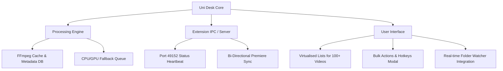

# Uni Desk (One Tap) — Feature Overview & Recommended Enhancements

---

## 🌟 Executive Summary & Feature Overview

**Uni Desk (One Tap Workstation)** is an all-in-one desktop workstation application built on Electron, React, and FFmpeg. It automates media ingest, title overlays, format conversion, Premiere Pro project generation, and cloud synchronization for professional video editors and production studios.

### 📦 Complete Feature Suite

| # | Feature / Module | Key Functionality |
|---|---|---|
| 1 | **🎬 Title Adder (`adder`)** | Automatically overlays titles, intros, outros, and background audio onto batch videos using FFmpeg. Features embedded camera sequence parsing, silence gap detection (`silencedetect`), special audio routing (Nikah, Waaz/ID), and real-time Premiere Pro extension sync. |
| 2 | **📸 Camera Transfer (`cameratransfer`)** | High-speed camera card ingest and file transfer. Auto-detects connected SD cards/drives, organizes footage into custom folder hierarchies, and maintains presets. |
| 3 | **🎞️ Premiere Project Generator (`prproj`)** | Auto-generates ready-to-edit `.prproj` sequence files from target folder structures or Excel manifests using embedded Python project automation scripts. |
| 4 | **🔀 Video & Photo Match Transfer (`videotransfer`)** | Matches corresponding photo and video files across directories using filename stems/timestamps, featuring dry-run checks and one-click undo transfers. |
| 5 | **📂 PV Separator (`pvseparator`)** | Ultra-fast Photo & Video Data Separator. Scans raw event folders and instantly segregates photos, RAW images, and video files into structured output directories with copy/move actions. |
| 6 | **🔄 Drive Sync (`drivesync`)** | Background cloud and local drive synchronization engine with progress tracking and exportable Excel & PDF summary reports. |
| 7 | **⚡ Media Converter (`converter`)** | Multi-threaded video and audio batch converter powered by FFmpeg. Supports preset resolutions, bitrate controls, codec selection (H.264/HEVC), and automatic PNG-to-JPEG watcher conversions. |
| 8 | **📁 Folder Maker (`folder`)** | Automated directory tree builder based on configurable client/event presets, complete with custom Adobe-style Windows folder icons (`desktop.ini`). |
| 9 | **👁️ Universal File Viewer (`viewer`)** | Built-in viewer supporting RAW camera images (CR2, NEF, ARW, DNG, etc.), high-res video streaming with byte-range seeking, PDFs, DOCX, XLSX, and Markdown. |
| 10 | **⚙️ System & Utilities (`utilities`, `cleaner`, `stats`, `notes`)** | System hardware monitor, GPU encoder detector (NVIDIA NVENC, Intel QSV, AMD AMF), workstation statistics logger, sticky note scratchpad, and temporary disk cleaner. |
| 11 | **🌐 Cloud & GDrive Portals (`cloud`, `gdrive`)** | Integrated webview portals for client delivery, Google Drive access, and cloud workspace management. |

---

## 💡 Recommended Enhancements & Best Practices

Below are strategic technical and user experience recommendations categorized by domain to elevate Uni Desk into an enterprise-grade production suite.

---

### 1. 🎬 Video Processing & Ingest Enhancements

> [!TIP]
> **FFmpeg Metadata Caching (`ffprobe`)**
> - **Problem**: Calling `ffprobe` synchronously for every video file in large batch folders (50+ clips) can take several seconds.
> - **Recommendation**: Maintain an SQLite or JSON file metadata cache keyed by `filePath + mtime + size`. If a video file hasn't changed on disk, read its resolution, duration, FPS, and audio stream count directly from cache.

> [!IMPORTANT]
> **GPU Hardened Fallback Loop**
> - Ensure FFmpeg encoding commands automatically fall back to CPU (`libx264`) if hardware acceleration (`h264_nvenc` or `hevc_qsv`) fails due to GPU VRAM exhaustion or driver mismatch during heavy batch rendering.

---

### 2. 🔌 Extension & Automation Enhancements

> [!NOTE]
> **Bi-Directional Premiere Pro WebSocket / HTTP Health Check**
> - Add a status indicator in the top toolbar showing **"Premiere Extension: Connected 🟢"** or **"Disconnected 🔴"**.
> - Support two-way communication so editors can click a button in Premiere Pro to "Send Active Sequence" or "Send Selected Clips" directly into Uni Desk Title Adder or Prproj Generator.

> [!TIP]
> **Auto-Watcher for Exported Clips**
> - Keep the folder watcher active on the batch source directory while Premiere Pro exports clips. As soon as a video export completes, auto-inject it into the queue without requiring any manual app refresh.

---

### 3. 🎨 UI & UX Polish

> [!TIP]
> **Batch Multi-Selection & Bulk Actions**
> - Allow selecting multiple videos in Title Adder using Shift+Click or Ctrl+Click to apply bulk audio assignments, toggle mute exceptions, or set custom title overlays simultaneously.

> [!NOTE]
> **Keyboard Shortcuts Modal (`?` Key)**
> - Add a global keyboard shortcuts cheat-sheet modal triggered by pressing `?` or `Ctrl+/`. Include shortcuts for:
>   - `Ctrl + K`: Command Palette
>   - `Ctrl + B`: Toggle Sidebar
>   - `Ctrl + R`: Rescan Batch Source Folder
>   - `Spacebar`: Preview selected video in File Viewer

---

### 4. 🛡️ Stability, Logging & Diagnostics

> [!WARNING]
> **Job Recovery on Unexpected Exit**
> - Persist active batch job states (completed videos vs pending videos) to disk in real-time. If the app is closed or system restarts during a 100-video batch run, offer a **"Resume Interrupted Job"** banner on startup.

> [!TIP]
> **Diagnostic Log Exporter**
> - Add a "Export Diagnostic Logs" button in Settings that packages the main process logs, FFmpeg stdout/stderr, and app version details into a `.zip` for quick troubleshooting support.

---

### 📂 Recommended Architectural Roadmap Summary

