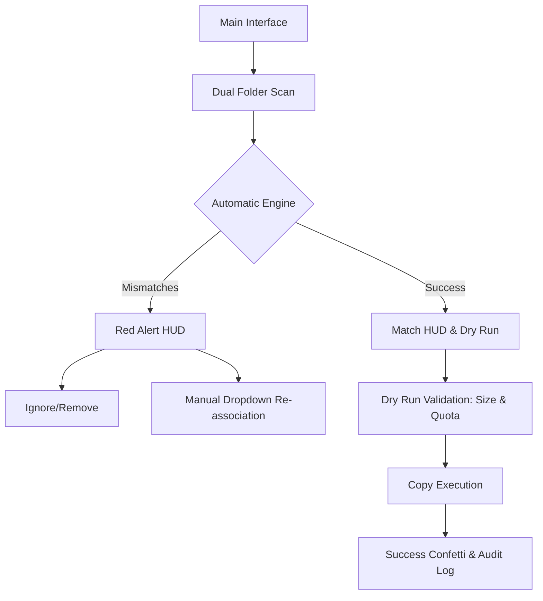

# UniDesk & ZenInfosys — Video & Photo Match Transfer Recommendations

This document outlines the current UI/UX features and provides targeted recommendations for the **Video & Photo Match Transfer Module** (available as both an Electron Workstation screen and a Google Apps Script Web App).

---

## 🔍 1. Current Feature UI/UX Breakdown

The current implementation (found in [VideoTransfer.tsx](file:///d:/One%20Tap_V20.6.5/src/renderer/src/pages/VideoTransfer/VideoTransfer.tsx), [videoTransfer.ipc.ts](file:///d:/One%20Tap_V20.6.5/src/main/ipc/videoTransfer.ipc.ts), [Code.gs](file:///d:/One%20Tap_V20.6.5/Match%20Video%20Photo_Appscript/Code.gs), and [Index.html](file:///d:/One%20Tap_V20.6.5/Match%20Video%20Photo_Appscript/Index.html)) includes:

*   **Dual-Folder Input Mode**: Dedicated directory browses (local) or Google Drive URL/ID fields (cloud) for separate Video and Photo folders.
*   **Date-Folder Scanning**: Automatically pairs subfolders inside the two main directories by matching date folder names (e.g. `17-01 01M`).
*   **Regex Sequence Parser**: Automatically extracts sequence numbers, prefixes, and name parts (e.g., matching `001 Q01.mp4` ↔ `001 Q01` folder).
*   **Mismatch HUD (Red Alert Panel)**: Flags unmatched files, missing date folders, or orphaned video/photo directories with "Ignore" or "Remove" options.
*   **Matched Table (Green Approved Badges)**: Shows matched pairs with visual status badges, sequence number tags, and folder names.
*   **Automated Copy Execution**: Executes local copying (Electron) or Google Drive copying (Apps Script) into respective photo subfolders.
*   **Progress Indicators & Log Console**: Real-time progress bar (local) and an execution log console displaying transferred items.

---

## 🚀 2. Proposed UI/UX Upgrades (Recommendations)

### 🎨 Visual & Layout Upgrades
*   **Real-Time Search & Tab Filtering**:
    *   Add a filter bar above the tables: `All`, `Matched`, `Mismatched`, `Ignored`, `Transferred`.
    *   Add a search box to quickly filter by filename, sequence, or date folder.
*   **Inline Drag-and-Drop Folder Selection**:
    *   Allow dragging directories directly from the OS file explorer into the Video/Photo input fields to set them instantly.
*   **Circular Progress and Speed/ETA Gauge**:
    *   Replace the linear progress bar with a detailed transfer panel showing: **ETA**, **Copy Speed (MB/s)**, and **Files remaining / Total bytes**.
*   **Subtle Hover Previews**:
    *   Hovering over matched rows could show a quick preview tool-tip (e.g., file size, full path, or file creation date).

### ⚙️ Functional & Interaction Upgrades
*   **Interactive Dropdown Manual Matcher**:
    *   *Current Issue*: If names differ slightly (e.g. `001-Q01.mp4` vs `001 Q01 (Photo)`), they end up in the Red Mismatch list and must be ignored or removed.
    *   *Solution*: Provide a dropdown picker next to unmatched video files, listing unmatched photo folders in the same date subfolder. This lets users **manually pair** them instead of throwing them away.
*   **Pre-Flight Dry Run & Storage Check**:
    *   A "Dry Run" preview button showing: total size of files to copy and a storage check validating if the destination drive/drive quota has enough free space.
*   **Custom Regex Rules Editor**:
    *   Provide a "Settings" modal to customize the parser regex patterns (e.g., if a team uses suffix codes like `Q01_001` instead of prefix codes `001 Q01`).
*   **File Name Collision Policies**:
    *   Add a dropdown selector to choose what happens if the video file already exists in the target folder:
        *   `Overwrite` (Replace existing)
        *   `Keep Both` (Auto-rename copy to `001 Q01_1.mp4`)
        *   `Skip` (Do not copy)

---

## ⚡ 3. Unified Cross-Platform Roadmap Suggestion

### 📋 Recommended Implementation Phase Tasks

- [ ] **Phase 1: Search & Filter Toolbar** — Implement client-side filtering and real-time search on the matches.
- [ ] **Phase 2: Manual Dropdown Matcher** — Allow re-associating mismatched items using a dropdown selector.
- [ ] **Phase 3: Collision Settings** — Allow selecting "Skip", "Overwrite", or "Rename" policies before executing transfers.
- [ ] **Phase 4: Pre-flight Storage Check** — Calculate target file sizes and warn if storage limit is exceeded.
