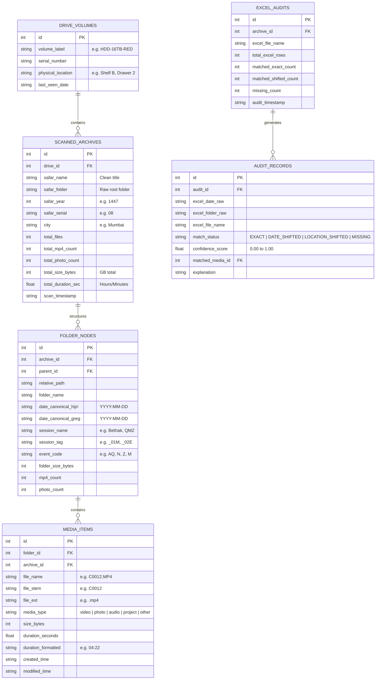
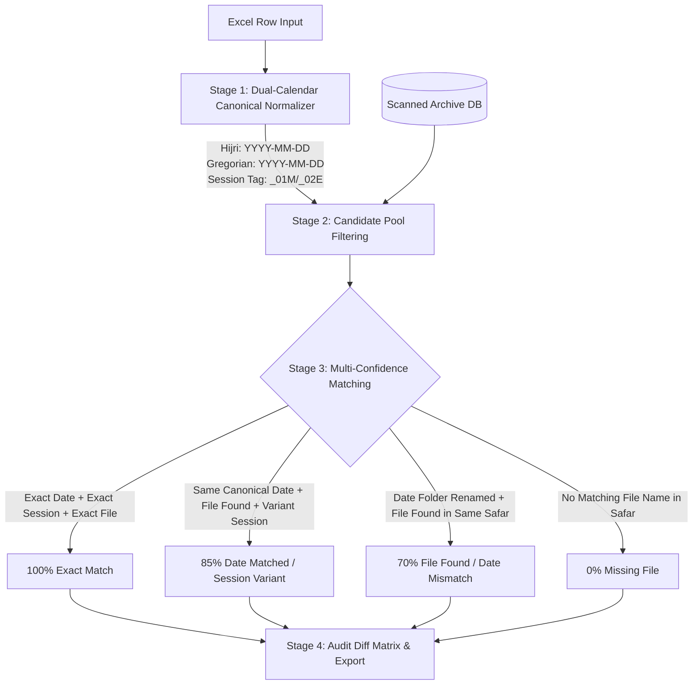

# VIRTUAL ARCHIVE VAULT & INTELLIGENT MEDIA RECONCILIATION ENGINE
### Comprehensive Technical Architecture & Feature Specification
**Project:** One Tap Workstation  
**Author:** Antigravity AI Engineering  
**Version:** 1.0.0  

---

## 1. Executive Summary & Objective

In video and media production environments (especially multi-day event and Safar recordings), teams generate hundreds of gigabytes or terabytes of footage per event spread across external hard drives, NAS storage, and local workstations. 

Two critical operational bottlenecks exist:
1. **The "Where is that Clip?" Problem (Disconnected / Deleted Media):** Hard drives are frequently unplugged, swapped, or wiped after archiving. Editors need an instant way to know whether a photo, MP4, or camera clip was ever recorded in a specific Safar, what its folder path was, how long it was, and which physical hard drive contains it—**without storing terabytes of actual video files locally**.
2. **The "Excel Audit Mismatch" Problem:** A current production sheet (`.xlsx`) lists items that *should* exist, but the folder naming and date conventions in historical archives differ from the Excel sheet (e.g. `1448-03-13 _01M` vs. `13/03/1448 Morning` vs. `2024-09-15`). Editors need a robust, accurate reconciliation tool to audit historical folders against current Excel sheets folder-wise, date-wise, and file-wise.

This specification details the **Zero-Storage Virtual Media Catalog** and the **Smart Excel Reconciliation Engine** designed to solve both problems with sub-millisecond query performance.

---

## 2. Zero-Storage Architecture Blueprint

### 2.1 How to Store Data for Sub-Millisecond Speed with Minimal Storage

* **Do NOT store actual media bytes:** Only extract and store structured metadata, directory hierarchies, and file metrics.
* **Storage Footprint:**
  * 10,000 files metadata ≈ **1.8 MB**
  * 100,000 files metadata ≈ **18 MB**
  * 1,000,000 files metadata ≈ **150 MB**
  Even a decade of media history fits comfortably inside a single lightweight database on the user's C: drive.
* **Database Engine:** Local **SQLite 3** running with **WAL (Write-Ahead Logging)** mode and **FTS5 (Full-Text Search)** enabled.
  * Lookups across 500,000 files take **< 3 milliseconds**.
  * Reads are non-blocking and concurrent.
  * Can be queried directly via Python (`sqlite3`) or Node (`better-sqlite3`).

---

### 2.2 Relational Database Schema (`archive_catalog.db`)



---

## 3. High-Speed Scanning & Ingestion Engine

### 3.1 Scanner Workflow

```
[User Selects Directory & Drive Label]
                 │
                 ▼
┌────────────────────────────────────────────────────────┐
│ 1. Asynchronous Directory Crawler (Thread Pool)        │
│    • Recurses directory tree using fast OS readdir.    │
│    • Ignores system junk: $RECYCLE.BIN, System Vol,    │
│      .DS_Store, thumbs.db, temp rendering caches.      │
└────────────────────────┬───────────────────────────────┘
                         │
                         ▼
┌────────────────────────────────────────────────────────┐
│ 2. Smart Hierarchy Extraction (via safarUtils.ts)      │
│    • Root Safar: Year, Serial, Safar Name, City.       │
│    • Date Folder: Hijri YYYY-MM-DD, Gregorian Date,   │
│      Session Tag (_01M, _02E).                         │
│    • Session / Category Folder: Event Codes (AQ, Z, etc)│
└────────────────────────┬───────────────────────────────┘
                         │
                         ▼
┌────────────────────────────────────────────────────────┐
│ 3. Fast File Metric Probing                            │
│    • Video (.mp4, .mov, .mkv): Parse 'moov/mvhd' atom  │
│      header in < 3ms without decoding frames.          │
│    • Photos (.arw, .cr3, .jpg, .png): Read stat size.  │
│    • Audio (.wav, .mp3): Header duration extraction.   │
│    • Accumulate folder GBs and video counts in memory. │
└────────────────────────┬───────────────────────────────┘
                         │
                         ▼
┌────────────────────────────────────────────────────────┐
│ 4. Bulk SQLite Transaction (WAL Mode)                  │
│    • Writes 10,000 files in a single atomic commit.    │
│    • Updates FTS5 full-text search virtual table.      │
│    • Frees memory immediately. Total time: ~8-15 sec  │
│      for 100,000 files.                                │
└────────────────────────────────────────────────────────┘
```

### 3.2 Video Duration Header Extraction (Zero-Decode Speed)
Instead of launching slow video decoders, the scanner inspects MP4/MOV headers:
1. Opens file in read-only binary mode.
2. Locates the `moov` atom followed by `mvhd`.
3. Reads `time_scale` (bytes 12-16) and `duration` (bytes 16-20).
4. `duration_seconds = duration / time_scale`.
5. Takes **under 2 milliseconds** per video, reading only a few kilobytes from the file header!

---

## 4. Intelligent Excel (.xlsx) Reconciliation Engine

### 4.1 The Core Problem: Format & Date Inconsistencies

| Dimension | In Excel File (`.xlsx`) | In Old Archive Folders |
| :--- | :--- | :--- |
| **Date Format** | `15/09/2024` or `13-Rabi-I-1448` or `Day 2` | `1448-03-13 _01M` or `13-03-1448` or `03-13` |
| **Session Representation** | `Morning Session` or `Session 1` | `_01M` or `01-Mumbai-Bethak` |
| **Event Category** | `Aqiqa` or `Ziyafat Lunch` | `-02-01AQ-` or `-04-01Z-` |
| **File Name** | `C0012` (no ext) or `C0012.MP4` | `C0012.MP4` or `1448-03-13_C0012.mov` |

Direct string matching fails 90% of the time. The reconciliation engine uses **4-Stage Canonical Normalization**:

---

### 4.2 The 4-Stage Reconciliation Pipeline



#### Stage 1: Dual-Calendar Canonical Normalization
* If Excel date is Gregorian (`2024-09-15`), the engine converts it using `hijriFromGregorian()` to `1448-03-13`.
* If Excel date is Hijri text (`13 Rabi I 1448`), it parses the month name to number (`1448-03-13`).
* Both dates are stored in canonical format (`YYYY-MM-DD`).
* Session keywords are mapped:
  * `Morning` / `S1` / `Subah` $\rightarrow$ `_01M`
  * `Evening` / `S2` / `Raat` $\rightarrow$ `_02E`

#### Stage 2: Event Code Extraction
* `Aqiqa` / `Bethak` $\rightarrow$ `AQ`
* `Ziyafat` $\rightarrow$ `Z`
* `Majlis` $\rightarrow$ `M`
* `Namaz` / `Nikaah` $\rightarrow$ `N`
* `Qadam` $\rightarrow$ `Q`
* `Waaz` $\rightarrow$ `WAAZ`

#### Stage 3: Scoring & Heuristic Matching
* **Confidence 1.0 (Exact):** File name matches, canonical date matches, and session tag matches.
* **Confidence 0.85 (Session Shift):** File name and date match, but session tag differs (e.g. logged as morning, found in evening folder).
* **Confidence 0.75 (Day Shift ±1 Day):** Night events often cross midnight (13th vs 14th). If the file exists in day ±1 under the same Safar, flag as Day-Shifted match.
* **Confidence 0.65 (Folder Name Discrepancy):** The file exists inside the Safar, but the old folder structure was unorganized or missing date tags.
* **Confidence 0.0 (Missing):** File does not exist anywhere in the scanned Safar.

---

## 5. Comprehensive Feature Set (All Recommended Capabilities)

### 5.1 Physical Storage & Drive Location Tracker (Virtual Disk Manager)
* **Problem:** Editors have 15 external hard drives on shelves. They don't know which drive holds the footage.
* **Solution:** 
  * Each scan associates the archive with a user-defined or volume-detected **Drive Tag** (e.g., `HDD-08-16TB-SEAGATE`, `Shelf 2, Drawer B`).
  * When searching for any file, the app displays:
    > *"Found in Safar 1447-08 Mumbai | Date: 1448-03-13 _01M*  
    > *Physical Location: **Drive #8 (Red Sticker) - Shelf 2, Drawer B***  
    > *File Size: 2.14 GB | Duration: 06:12 min"*

---

### 5.2 Instant Global Search & Multi-Filter Engine
* **Instant Auto-complete Search:** Search by file name, partial name (`C001*`, `IMG_8*`), or event name.
* **Filter by Safar:** Dropdown of all historical Safars (e.g. `1447-08 Mumbai`, `1446-04 Surat`).
* **Media Type Tabs:**
  * `[All Files]` `[Videos Only (.mp4, .mov)]` `[Photos Only (.arw, .cr3, .jpg)]` `[Premiere Projects (.prproj)]` `[Audio (.wav)]`
* **Duration Filter Slider:** Filter videos between `0 min` and `60+ mins`.
* **Event Code Filter:** Quickly show only `Ziyafat (Z)` or `Bethak (AQ)` clips.

---

### 5.3 Camera Sequence Continuity & Gap Detector
* **Problem:** A camera records clips `C0001.MP4`, `C0002.MP4`, `C0004.MP4`. If `C0003.MP4` was accidentally left on the SD card, nobody notices until months later.
* **Solution:** 
  * The scanner checks alphanumeric camera sequence numbering.
  * If a sequence break is detected in a folder, it marks an alert:
    > *⚠️ Missing Sequence Detected:* `C0003.MP4` missing between `C0002.MP4` and `C0004.MP4` in folder `_01M-02-01AQ`.

---

### 5.4 Cross-Drive Ghost & Duplicate File Detector
* Identifies identical files stored in multiple folders or on different drives (matching file stem + size + duration).
* Displays a **Storage Reclamation Report** showing how many gigabytes are wasted on duplicate backups.

---

### 5.5 High-Level Safar Analytics Dashboard
* **Safar Overview Card:**
  * Total Storage: `3.42 TB`
  * Video Count: `412 MP4s` (`58 hrs 42 mins` total footage)
  * Photo Count: `3,180 RAW/JPGs`
  * Event Distribution: Donut chart showing Bethak, Majlis, Ziyafat, Namaz proportions.
* **Storage Comparison Chart:** Compare footage volume across different Safars or years.

---

### 5.6 Interactive Excel Verification & Audit UI (Visual Diff)
* Drag & drop any `.xlsx` file.
* Select mapping columns:
  * `Column A: Date`
  * `Column B: Session / Folder`
  * `Column C: File Name`
* Runs instant reconciliation and displays an interactive color-coded matrix:
  * 🟢 **Green (Verified Exact):** File found in expected date & folder.
  * 🟡 **Yellow (Date / Session Shift):** File found, but date folder or session had naming difference.
  * 🔴 **Red (Missing in Archive):** File in Excel was never found in scanned data.
  * 🟣 **Purple (Uncataloged in Excel):** Extra files present in the archive that were omitted from Excel.
* **1-Click Export:** Download a complete `Audit_Discrepancy_Report.xlsx` with highlighted missing items.

---

### 5.7 Lightweight Portable Catalog Export (`.otcat` / `.json.gz`)
* Export any Safar's scanned catalog as a compressed **`.otcat`** file (~250 KB).
* Can be emailed, shared via WhatsApp, or synced via Google Drive to other team members who don't have the physical hard drive.
* Other editors can import the `.otcat` file into their One Tap app and search the entire archive offline.

---

### 5.8 Zero-Byte & Corrupt File Sentry
* Flags files with `0 bytes` (corrupt transfers) or invalid MP4 headers during scanning so editors can re-transfer them before wiping SD cards.

---

## 6. System Architecture & File Placement in One Tap

```
One Tap Codebase Integration:
│
├── src/main/python/
│   ├── archive_catalog_db.py       # SQLite schema, FTS5 setup, CRUD queries
│   ├── archive_scanner.py          # Parallel folder crawler & fast MP4 atom header parser
│   └── excel_reconciler.py         # 4-stage Hijri/Gregorian Excel matching engine
│
├── src/main/ipc/
│   └── archiveCatalog.ipc.ts       # IPC handlers for scan, search, audit, export
│
├── src/renderer/src/
│   ├── pages/
│   │   └── ArchiveVault/
│   │       ├── ArchiveVault.tsx    # Main Tab: Catalog Viewer, Search, Excel Audit
│   │       ├── ArchiveVault.css    # Premium dark-mode styling
│   │       ├── components/
│   │       │   ├── CatalogSearch.tsx      # Instant search bar + filters
│   │       │   ├── SafarSummaryCard.tsx   # GB, duration, count analytics
│   │       │   ├── ExcelAuditMatrix.tsx   # Excel drag-and-drop & diff viewer
│   │       │   ├── DriveManagerModal.tsx  # Physical drive/shelf tracker
│   │       │   └── SequenceGapAlert.tsx   # Missing clip sequence alert
│   │
│   └── utils/
│       ├── safarUtils.ts           # Existing hierarchy & prefix parser
│       └── dateUtils.ts            # Existing Hijri/Gregorian converter
```

---

## 7. Step-by-Step Implementation Roadmap

| Phase | Milestone | Deliverables |
| :---: | :--- | :--- |
| **Phase 1** | **Database & Core Engine** | • Implement `archive_catalog_db.py` with indexed SQLite tables.<br>• Implement `archive_scanner.py` with parallel crawler and MP4 atom parser.<br>• Benchmark: 50,000 files scanned in < 10 seconds. |
| **Phase 2** | **IPC & Search API** | • Implement `archiveCatalog.ipc.ts`.<br>• Expose `scanArchive()`, `searchCatalog()`, `getSafarStats()`, `listSafars()`. |
| **Phase 3** | **Excel Reconciliation Engine** | • Implement `excel_reconciler.py` with multi-tier date normalization.<br>• Implement Excel row matcher and discrepancy classifier.<br>• Export verified / missing audit workbooks. |
| **Phase 4** | **Renderer UI (`ArchiveVault`)** | • Create dedicated `ArchiveVault` page in One Tap with glassmorphic dark UI.<br>• Add Safar selection bar, search box, media type pills, and results table.<br>• Add Excel dropzone and audit diff inspector matrix. |
| **Phase 5** | **Polish & Advanced Tools** | • Add Camera Sequence Gap detector.<br>• Add Physical Drive location manager modal.<br>• Add `.otcat` portable export/import. |

---

## 8. Summary of Benefits

1. **Zero Storage Impact:** Millions of files stored in ~50 MB instead of hundreds of terabytes.
2. **Instant Offline Lookup:** Know in 2 milliseconds if a video was taken, where it was stored, and its duration—even when the drive is in a drawer.
3. **Flawless Excel Auditing:** Automatically reconciles date folder naming mismatches using dual-calendar Hijri/Gregorian normalization.
4. **Production Peace of Mind:** Never lose track of a camera card, missing sequence, or misplaced event recording.
