<div align="center">

<!-- ========================================== -->
<!-- 🚀 DYNAMIC ANIMATED CYBER HUD HERO BANNER  -->
<!-- ========================================== -->
<a href="https://github.com/BSFrameWorks5253/onetap-workstation">
  
</a>

<br/><br/>

<!-- App Icon with Raw GitHub Fallback Anchor -->
<a href="https://github.com/BSFrameWorks5253/onetap-workstation">
  
</a>

<h2 align="center">⚡ Enterprise Video Production Workstation &amp; Batch Rendering Engine ⚡</h2>

<!-- ========================================== -->
<!-- 💻 LIVE CONSOLE TERMINAL SIMULATOR SVG      -->
<!-- ========================================== -->


<br/><br/>

<!-- ========================================== -->
<!-- 🛡️ STATUS & TECHNOLOGY SHIELDS MATRIX     -->
<!-- ========================================== -->
[](https://github.com/BSFrameWorks5253/onetap-workstation/releases)
[-10B981?style=for-the-badge&logo=githubactions&logoColor=white)](https://github.com/BSFrameWorks5253/onetap-workstation)
[](https://electronjs.org)
[](https://typescriptlang.org)
[](https://react.dev)
[](https://ffmpeg.org)
[](https://microsoft.com/windows)

<br/><br/>

<!-- ========================================== -->
<!-- 🌟 HIGH-IMPACT CALL-TO-ACTION BUTTONS      -->
<!-- ========================================== -->
<a href="https://github.com/BSFrameWorks5253/onetap-workstation/releases/latest">
  
</a>
&nbsp;&nbsp;
<a href="https://github.com/BSFrameWorks5253/onetap-workstation/releases">
  
</a>
&nbsp;&nbsp;
<a href="#-animated-batch-pipeline">
  
</a>

<br/><br/>

<!-- Interactive Quick Links -->
<p align="center">
  <a href="#-overview"><b>Overview</b></a> •
  <a href="#-animated-batch-pipeline"><b>Batch Pipeline</b></a> •
  <a href="#-key-features"><b>Key Features</b></a> •
  <a href="#-performance-benchmarks"><b>Benchmarks</b></a> •
  <a href="#-token-saving-cache-system"><b>Token Cache (~891K)</b></a> •
  <a href="#-visual-preloaders--themes"><b>Preloaders &amp; Wipe FX</b></a> •
  <a href="#-quick-start"><b>Quick Start</b></a> •
  <a href="#️-architecture"><b>Architecture</b></a>
</p>

<!-- Cyber Glow Divider -->


</div>

<br/>

## 🎬 Overview

**UniDesk Studio** is an ultra-fast automated video production workstation and media asset engine designed for professional broadcast teams, event videographers, and commercial studios. Built with **Electron 30**, **React 18**, and **TypeScript**, it interfaces directly with hardware-accelerated **FFmpeg pipelines** (NVENC, Intel QuickSync, multi-core CPU) to streamline batch title additions, watermark overlays, audio multiplexing, and media asset management.

```
┌──────────────────────────────────────────────────────────────────────────────────┐
│  🚀 HARDWARE NVENC ACCELERATION       │  📦 MULTI-FOLDER DRAG & DROP QUEUE (1..N)│
│  🖼️ DYNAMIC 4K PHOTO PAIRING & MOVE   │  🧠 SHA-256 TOKEN CACHE ENGINE (~891K)  │
│  🖥️ WINDOWS TASKBAR HOVER PREVIEWS    │  ✨ 5 AWWWARDS-GRADE KINETIC PRELOADERS  │
│  ⚡ BROADCAST RTL WIPE ANIMATIONS      │  💎 ARCHITECTURAL LIQUID GLASS UI        │
└──────────────────────────────────────────────────────────────────────────────────┘
```

---

## ⚡ Animated Batch Pipeline

Watch data traverse through UniDesk Studio's sequential multi-batch rendering pipeline in real time:

<div align="center">
  
</div>

1. **📁 Multi-Folder Drag & Drop**: Drop 2, 3, or $N$ event folders simultaneously into the workstation to initialize the batch queue.
2. **⚡ Sequential Priority Engine**: Queue items execute sequentially (#1 first, #2 second) with automated DVD subfolder discovery.
3. **🖼️ Intelligent Photo Pairing & Renamer**: Synchronously pairs rendered video titles with their high-resolution camera JPEGs and relocates them into organized event destinations.
4. **🚀 Hardware-Accelerated Rendering**: Utilizes NVENC CUDA cores & Intel QSV to export videos at up to **14.8x real-time speed**.
5. **🎬 Master Delivery**: Clean exports with zero frame drops, automated audio multiplexing, and full progress tracking.

---

## ✨ Key Features

### 1. 🎬 Multi-Batch Video Queue Engine (1..$N$)
- **Unlimited Batch Stacking**: Queue any number of event folders simultaneously.
- **Dynamic Reordering**: Reorder queued batches on the fly with live priority updates; source paths, destination folders, and photo transfer directories immediately sync across the workstation.
- **Automatic DVD Discovery**: Automatically scans event root directories for DVD subfolders and organizes titles.

### 2. 🖥️ Windows Taskbar-Style Live Hover Previews
- Hovering over sidebar navigation icons renders instant, interactive popover window previews mimicking the native Windows 11 taskbar experience.
- Features page headers, live status chips, active queue states, and execution controls with an ergonomic 240ms debounce.

### 3. 🖼️ Intelligent Photo Pairing & Batch Renamer
- Automatically pairs rendered video titles with their corresponding high-resolution camera JPEGs.
- Dedicated **⚡ Rename & Move ALL Batches** pipeline transfers, organizes, and names photos into separate event destination folders in one click.

### 4. 🧠 Codebase Token-Saving Analysis Engine (~891,818 Tokens Saved)
- **Persistent Local Knowledge Base**: Incrementally hashes modified files using SHA-256 and mirrors folder structures into `.code-analysis/`.
- Prevents expensive token-draining codebase re-scans by AI assistants, saving **over ~891,818+ AI context tokens** per session!

### 5. 🎨 5 Awwwards-Grade Kinetic Preloaders & RTL Wipe Animation
- **Broadcast Right-to-Left (RTL) Wipe Animation**: Seamless calligraphy wipe reveal with a synchronized golden luminous light beam sweeping across the text.
- **Authentic ONTO Kinetic Typography**: Precise 5-stage mechanical choreography (rising blocks, cutouts, horizontal squeeze, infinity chain merge, and expansion portal).
- **Astral Frontier**: Concentric orbital planetary rings with live telemetry.
- **Walbi Audio Pulse**: Frequency-reactive soundwave equalizer bars.
- **Spasoje Perovic**: Minimalist Swiss brutalist oversized numeric ticker.
- **Mobbin Workstation Dock**: Floating mobile-inspired checklist card.

### 6. 🌙 Refined Visual Architecture & Anti-Eye-Strain Design
- Balanced contrast palette with deep slate surfaces (`#0D1117`), softened off-whites (`#F8FAFC`), and vibrant amber/indigo accents (`#F59E0B`, `#6366F1`).
- Completely eliminates eye-strain during extended overnight editing and batch rendering sessions.

---

## 📊 Performance Benchmarks

UniDesk Studio leverages dedicated GPU video encoders (NVENC / QuickSync) alongside multi-threaded CPU pipelines:

| Pipeline Engine | Encoding Speed | 1-Hour 4K Master Render | GPU Offload | CPU Utilization |
| :--- | :---: | :---: | :---: | :---: |
| **Standard CPU (libx264)** | `1.0x` | ~58 mins | 0% | 98% (High Heat) |
| **Intel QuickSync (QSV)** | `8.4x` | ~7 mins | 65% | 22% (Cool) |
| **NVIDIA NVENC (CUDA)** | **`14.8x`** | **~3.9 mins** | **94%** | **8% (Ultra Cool)** |

```
CPU Software  [████░░░░░░░░░░░░░░░░] 1.0x (Baseline)
Intel QSV     [████████████░░░░░░░░] 8.4x
NVIDIA NVENC  [████████████████████] 14.8x (BLAZING FAST)
```

---

## 🧠 Token-Saving Cache System

```
┌────────────────────────────────────────────────────────────────────────┐
│  AI CONTEXT TOKEN SAVINGS (Local Knowledge Base vs Full Re-Scan)       │
├────────────────────────────────────────────────────────────────────────┤
│  Full Codebase Re-Scan:   900,000 Tokens (Drains Context Window)       │
│  UniDesk SHA-256 Cache:     8,182 Tokens (Only delta diff loaded)      │
│  TOTAL SAVINGS:           891,818 TOKENS (99.4% CONTEXT PRESERVED!)    │
└────────────────────────────────────────────────────────────────────────┘
```

Update your local knowledge base cache anytime via CLI:
```bash
npm run analyze:cache
```

---

## 🚀 Quick Start

### Prerequisites
- **Node.js**: v18.0.0 or higher
- **npm**: v9.0.0 or higher
- **FFmpeg**: Bundled automatically with hardware NVENC/QSV support

### Installation & Launch

```bash
# 1. Clone repository
git clone https://github.com/BSFrameWorks5253/onetap-workstation.git
cd onetap-workstation

# 2. Install dependencies
npm install

# 3. Launch Development Workstation
npm run dev

# 4. Build Production Executable (.exe)
npm run build:win
```

---

## ⌨️ Keyboard Shortcuts

| Shortcut | Action | Scope |
| :--- | :--- | :--- |
| <kbd>Ctrl</kbd> + <kbd>N</kbd> | Add new folder to batch queue | Title Adder |
| <kbd>Ctrl</kbd> + <kbd>Enter</kbd> | Start batch rendering pipeline | Title Adder |
| <kbd>Ctrl</kbd> + <kbd>Shift</kbd> + <kbd>R</kbd> | Rename & Move photos across all batches | Video Transfer |
| <kbd>Ctrl</kbd> + <kbd>T</kbd> | Open Power Hub quick switcher | Global |
| <kbd>Ctrl</kbd> + <kbd>D</kbd> | Toggle Dark / Light eye-comfort mode | Global |
| <kbd>Esc</kbd> | Dismiss modals, previews & welcome screen | Global |

---

## 🏗️ Architecture

```
onetap-workstation/
├── src/
│   ├── main/                 # Electron main process (FFmpeg, File I/O, IPC)
│   │   ├── index.ts          # Window lifecycle & hardware bindings
│   │   └── ffmpegHelper.ts   # NVENC & QSV acceleration pipes
│   ├── preload/              # Secure context-isolation bridge
│   └── renderer/             # React 18 UI Workstation
│       ├── components/
│       │   ├── TaskbarPreview/ # Live Windows 11 hover popovers
│       │   ├── WelcomeScreen/  # Islamic RTL wipe calligraphy & preloaders
│       │   ├── Loaders/        # 5 Awwwards-grade kinetic preloaders
│       │   └── Sidebar/        # Workspace navigation & status chips
│       ├── pages/
│       │   ├── TitleAdder/     # Sequential multi-batch queue engine
│       │   ├── VideoTransfer/  # 4K photo pairing & auto relocation
│       │   ├── Converter/      # Batch transcoder & preset engine
│       │   └── Settings/       # Eye-comfort themes & hardware configs
│       └── stores/           # Zustand state (Queue, Photos, Preferences)
├── resources/                # App logos, animated SVG vectors, and assets
└── .code-analysis/           # Persistent local knowledge base (~891k saved)
```

---

## 📜 Licensing & Commercial Terms

**UniDesk Studio** is licensed under the **Commercial Software License Agreement & EULA**.

- **🎨 100% Unrestricted Output Ownership**: You retain full, exclusive, royalty-free commercial ownership and copyright over all videos, sequences, photos, audio tracks, and client projects rendered or processed using the workstation.
- **🔒 Strictly On-Premise Execution**: Video transcoding, title insertion, photo reorganization, and token cache indexing (`.code-analysis/`) operate 100% locally on your machine. **No footage or private event media is ever transmitted to external servers.**
- **Enterprise & Multi-Seat Deployments**: For custom studio integrations or volume licensing, contact `bs.framework5253@gmail.com`.

📄 Read the full legal terms: [**LICENSE**](LICENSE) • Detailed Product Architecture: [**PROJECT_DESCRIPTION.md**](Docs/PROJECT_DESCRIPTION.md)

---

<div align="center">

<!-- Bottom Animated Gradient Wave -->


<br/>

**UniDesk Studio** • Crafted with precision for high-speed automated video production.

<sub>Copyright © 2024–2026 BS Framework. All rights reserved.</sub>

</div>
