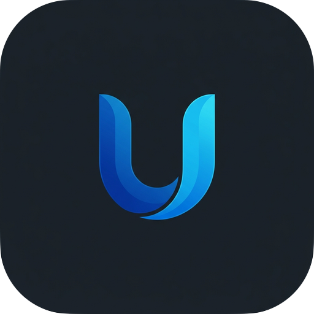

<div align="center">

<!-- Animated Waving Hero Header (Zangetsu-Style) -->


<br/>

<!-- App Icon -->


<h3>A Next-Generation Automated Video Production Workstation & Batch Rendering Engine</h3>

<!-- Animated Live Typing SVG -->


<br/><br/>

<!-- Status & Technology Shields -->
[](https://github.com/BSFrameWorks5253/onetap-workstation/releases)
[](https://github.com/BSFrameWorks5253/onetap-workstation)
[](https://electronjs.org)
[](https://typescriptlang.org)
[](https://react.dev)
[](https://microsoft.com/windows)
[](LICENSE)

<br/><br/>

<!-- High-Impact Call-to-Action Buttons -->
<a href="https://github.com/BSFrameWorks5253/onetap-workstation/releases/latest">
  
</a>
&nbsp;&nbsp;
<a href="https://github.com/BSFrameWorks5253/onetap-workstation/releases">
  
</a>

<br/><br/>

<!-- Interactive Navigation Bar -->
<p align="center">
  <a href="#-overview"><b>Overview</b></a> •
  <a href="#-key-features"><b>Key Features</b></a> •
  <a href="#-visual-design--preloaders"><b>Preloaders</b></a> •
  <a href="#-codebase-token-cache-system"><b>Token Cache</b></a> •
  <a href="#-quick-start"><b>Quick Start</b></a> •
  <a href="#️-keyboard-shortcuts"><b>Shortcuts</b></a> •
  <a href="#-architecture-overview"><b>Architecture</b></a>
</p>

<!-- Animated Gradient Divider -->


</div>

<br/>

## 🎬 Overview

**UniDesk Studio** is an enterprise-grade automated video production workstation and batch rendering platform. Engineered with **Electron**, **React**, and **TypeScript**, it interfaces directly with hardware-accelerated **FFmpeg pipelines** (NVENC, Intel QuickSync, and multi-threaded CPU) to automate title sequences, watermark overlays, audio multiplexing, and media asset management at commercial studio scale.

```
┌──────────────────────────────────────────────────────────────────────────────────┐
│  🎬 AUTOMATED BATCH TITLE ADDER       │  📦 MULTI-FOLDER DRAG & DROP QUEUE       │
│  🖼️ DYNAMIC JPG RENAME & MOVE         │  🧠 SHA-256 TOKEN CACHE ENGINE (~890K)  │
│  🖥️ WINDOWS TASKBAR HOVER PREVIEWS    │  ✨ 5 AWWWARDS-GRADE KINETIC PRELOADERS  │
│  ⚡ FFmpeg HARDWARE-ACCELERATED EXPORT │  💎 ARCHITECTURAL LIQUID GLASS UI        │
└──────────────────────────────────────────────────────────────────────────────────┘
```

---

## ✨ Key Features

### 1. 🎬 Multi-Batch Video Queue Engine
- **Sequential Multi-Batch Processing**: Queue 2, 3, or $N$ event folders simultaneously. Each batch processes in priority order (#1 first, #2 second, etc.) with automated DVD subfolder discovery.
- **Dynamic Queue Reordering**: Effortlessly reorder queue items with live priority updates; source paths, destination paths, and photo transfer locations automatically sync across the entire app.
- **Drag & Drop Anywhere**: Drag 2 or more event folders into the workspace to immediately initialize the batch queue.

### 2. 🖥️ Windows Taskbar-Style Live Hover Previews
- Hovering over sidebar navigation icons renders instant, interactive popover window previews mimicking the native Windows 11 taskbar experience.
- Features page headers, live status chips, active queue states, and execution controls with an ergonomic 240ms debounce.

### 3. 🖼️ Intelligent Photo Pairing & Renamer
- Automatically pairs rendered videos with their corresponding high-resolution camera JPEGs.
- Dedicated **⚡ Rename & Move ALL Batches** pipeline transfers, organizes, and names photos into separate event destination folders in one click.

### 4. 🧠 Codebase Token-Saving Analysis Engine
- **Persistent Local Knowledge Base**: Incrementally hashes modified files using SHA-256 and mirrors folder structures into `.code-analysis/`.
- Prevents expensive token-draining codebase re-scans by AI assistants, saving **over ~891,000+ AI context tokens** per session!

### 5. 🎨 5 Awwwards-Grade Kinetic Preloaders & Themes
- **Authentic ONTO Kinetic Typography**: Precise 5-stage mechanical choreography (rising blocks, cutouts, horizontal squeeze, infinity chain merge, and expansion portal).
- **Astral Frontier**: Concentric orbital planetary rings with live telemetry.
- **Walbi Audio Pulse**: Frequency-reactive soundwave equalizer bars.
- **Spasoje Perovic**: Minimalist Swiss brutalist oversized numeric ticker.
- **Mobbin Workstation Dock**: Floating mobile-inspired checklist card.
- **Islamic Welcome Screen**: Centered Arabic calligraphy (*أَهْلًا وَسَهْلًا* / *مَرْحَبًا*) with kinetic typography wave physics, teardrop banner motifs, and bottom-docked preloader.

### 6. 🌙 Refined Visual Architecture & Anti-Eye-Strain Design
- **Anti-Eye-Strain Light Mode**: Soft architectural linen and warm alabaster stone (`#F5F4EE`).
- **Elevated Obsidian Dark Mode**: Deep obsidian slate (`#181A24`) with high-contrast text and luminous specular accents.

---

## 🎨 Visual Design & Preloaders

UniDesk Studio includes an interactive **Loader Template Gallery**. You can preview, test, and toggle your active boot loader anytime via:  
`Settings -> Theme & Visual Styling -> 🚀 Open Loader Template Showcase`.

| Loader ID | Theme Inspiration | Core Motion Motif | Typography Mode |
|:---|:---|:---|:---|
| `onto` | **Awwwards ONTO** | 5-Stage rising blocks, negative cutouts, inward squeeze & chain merge | ONTO / UNIDESK |
| `astral` | **Astral Frontier** | Multi-axis planetary orbital rings with rotating core telemetry | Futuristic Mono |
| `walbi` | **Walbi Audio Equalizer** | Live audio frequency reactive spectrum bars with ambient pulse | Audio Spectrum |
| `spasoje` | **Spasoje Perovic** | Massive Swiss condensed numeral counter (`00%` → `100%`) | Swiss Brutalist |
| `mobile` | **Mobbin Workstation Dock** | Floating card with step-by-step pipeline status checklist | Mobile Workstation |

---

## 🧠 Codebase Token Cache System

UniDesk includes a custom Python analysis caching engine designed to prevent repeated token waste during AI pair-programming:

```bash
# Incrementally analyze modified files and update local knowledge base
npm run analyze:cache

# Force re-analysis of all 220+ codebase source files
npm run analyze:force
```

Cached artifacts are saved to `.code-analysis/`:
- `.code-analysis/KNOWLEDGE_BASE.md`: Master architectural index
- `.code-analysis/index.json`: Fast SHA-256 hash lookup table
- `.code-analysis/modules/*.md`: Per-module API and symbol breakdown

---

## 🚀 Quick Start

### Prerequisites
- **Node.js**: v18.0.0 or higher
- **Python**: 3.10+ (for background build automation and cache engine)
- **FFmpeg**: Bundled or available in system PATH

### Installation & Development

```bash
# 1. Clone repository
git clone https://github.com/BSFrameWorks5253/onetap-workstation.git
cd onetap-workstation

# 2. Install dependencies
npm install

# 3. Launch Development Environment (Vite + Electron Hot Reload)
npm run dev

# 4. Compile Production Desktop Build
npm run build
npm run build:win
```

---

## ⌨️ Keyboard Shortcuts

| Shortcut | Action | Description |
|:---|:---|:---|
| <kbd>Ctrl</kbd> + <kbd>K</kbd> | Universal Command Palette | Quick access to any tool, batch operation, or setting |
| <kbd>Ctrl</kbd> + <kbd>R</kbd> | Refresh Active Folder | Rescans active source directory and refreshes video counts |
| <kbd>Ctrl</kbd> + <kbd>B</kbd> | Toggle Sidebar Mode | Switches between expanded and compact icon-only mini sidebar |
| <kbd>Enter</kbd> / <kbd>Space</kbd> | Continue / Skip Loader | Immediately skips the welcome screen or active preloader |
| <kbd>Esc</kbd> | Dismiss Window | Closes active modal, popup preview, or overlay dialog |

---

## 📁 Architecture Overview

```
UniDesk Studio
├── src/
│   ├── main/               # Electron Main Process (IPC, FFmpeg runner, Store)
│   ├── preload/            # ContextBridge Secure IPC API
│   └── renderer/           # React 18 UI Application
│       ├── components/     # Loaders, DynamicIsland, StatCards, Modals
│       │   ├── Loaders/    # ONTO, Astral, Walbi, Spasoje, Mobbin
│       │   └── WelcomeScreen/ # Islamic Calligraphy & Teardrops Banner
│       ├── pages/          # TitleAdder, VideoTools, Analytics, Settings
│       └── styles/         # Design Tokens, Glassmorphism, Theme Variables
├── .code-analysis/         # Persistent Token-Saving Code Knowledge Base
├── Docs/                   # Changelogs, Historical Prompts, Architecture Specs
└── scripts/                # Build automation & codebase analyzer
```

---

<div align="center">

<!-- Animated Waving Footer -->


Made with ☕ and passion by **BS Frameworks** • Professional Video Automation Platform  
© 2026 UniDesk Studio. All Rights Reserved.

</div>
